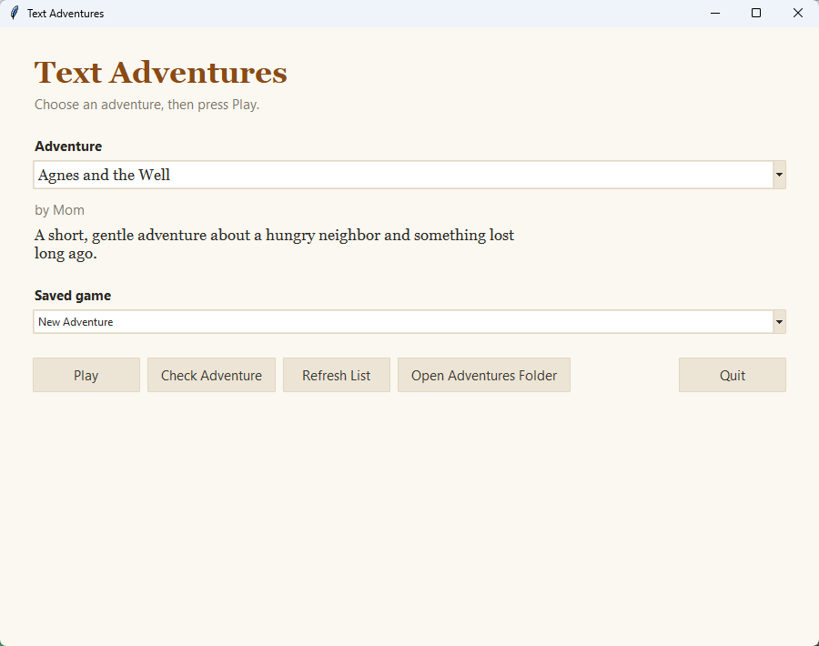
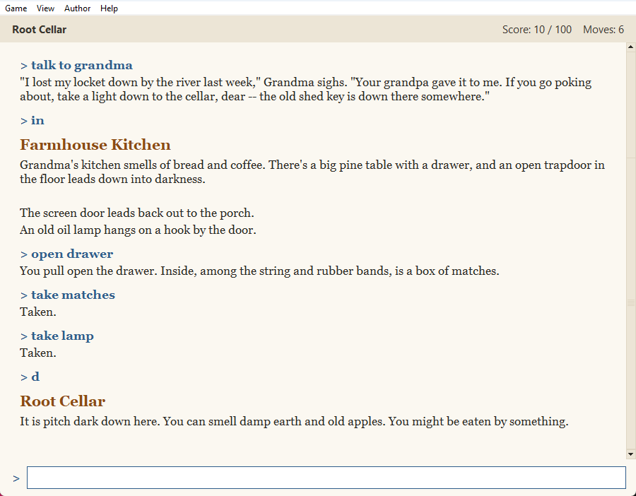
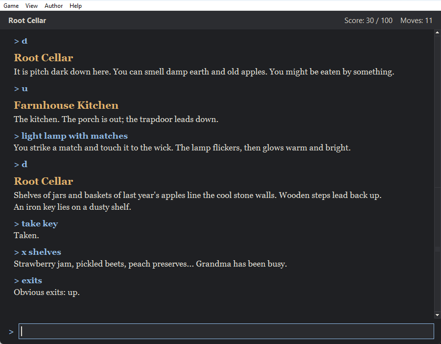

# Adventure Engine

Write your own text adventure games in a plain text file, then play them in a simple window. It's in the spirit of Zork and the other classic adventures.



You type what you want to do, in ordinary words, and the game tells you what happens:



- **To play**, read on.
- **To write your own adventures**, see the [Authoring Guide](docs/AUTHORING.md).

---

## What You Need

- A computer running **Windows** or **Linux**.
- **Python** (free). The steps below show how to install it.
- **Notepad++** (free) if you want to write adventures. Any plain text editor will do, but Notepad++ is easiest.

---

## Step 1: Install Python

You only need to do this once.

### On Windows

1. Go to **[python.org/downloads](https://www.python.org/downloads/)**.
2. Click the big yellow **Download Python** button.
3. Open the file you downloaded.
4. **Important:** at the bottom of the first window, tick the box that says **Add python.exe to PATH**.
5. Click **Install Now** and wait for it to finish.

### On Linux

Open a terminal and type the line for your system.

On Ubuntu, Linux Mint or Debian:

```
sudo apt install python3 python3-tk
```

On Fedora:

```
sudo dnf install python3 python3-tkinter
```

---

## Step 2: Get the Game

1. On this page on GitHub, click the green **Code** button near the top, then click **Download ZIP**.
2. Find the downloaded file (usually in your **Downloads** folder).
3. Right-click it and choose **Extract All...** to unzip it.
4. Move the folder somewhere easy to find, such as your **Documents** folder.

---

## Step 3: Start the Game

### On Windows

Open the game's folder and **double-click `adventure.pyw`**.

> **Tip:** right-click `adventure.pyw` and choose **Send to > Desktop (create shortcut)** to put a shortcut on your desktop.

### On Linux

Open a terminal in the game's folder and type:

```
python3 adventure.py
```

---

## How to Play

1. Choose an adventure from the list.
2. Click **Play**.
3. If you've saved games in this adventure before, you'll see them on the next screen. Pick one and click **Continue** to carry on where you left off, or click **New Adventure** to start from the beginning.

Read the story, then type what you'd like to do in the box at the bottom and press **Enter**.

| To... | Type something like... |
|---|---|
| Move around | `north`, `south`, `east`, `west`, `up`, `down`, `in`, `out` (or just `n`, `s`, `e`, `w`, `u`, `d`) |
| Look around again | `look` (or `l`) |
| Look closely at something | `examine the lamp` (or `x lamp`) |
| Pick something up | `take the rope` |
| Put something down | `drop the rope` |
| See what you're carrying | `inventory` (or `i`) |
| Do something | `open the door`, `talk to Agnes`, `give the pie to Agnes`, `climb the tree`... try anything! |
| Repeat your last command | `again` (or `g`) |
| See your score | `score` |
| See which ways you can go | `exits` |

You can type several commands at once by separating them with commas: `take the rope, then go north`.

Press the **Up arrow** key to bring back things you typed before.

### Saving your game

- **Game > Save** (or **Ctrl+S**) saves your progress.
- **Game > Load...** picks up a saved game.
- If you try to quit without saving, the game will ask whether you'd like to save first.

### Making the text bigger

- **View > Larger Text** (or **Ctrl** and **=**) makes the words bigger.
- **View > Smaller Text** (or **Ctrl** and **-**) makes them smaller.
- **View > Dark Theme** gives light text on a dark background, which some people find easier on the eyes.

The game remembers your choices for next time.



---

## Adding Adventures

Adventures are files ending in **.adv**. They live in the **adventures** folder inside the game's folder. Click **Open Adventures Folder** on the start screen to find it.

To add an adventure someone has sent you, put the **.adv** file in that folder and click **Refresh List**.

Two adventures come with the game:

- **Grandma's Locket** (`tutorial.adv`), a small adventure that shows off everything the game can do.
- **Agnes and the Well** (`agnes_and_the_well.adv`), a very short one.

To write your own, see the **[Authoring Guide](docs/AUTHORING.md)**.

---

## Optional: Make a Windows Program (.exe)

If you'd like to give the game to someone without making them install Python, you can turn it into an ordinary Windows program. You need Python installed on **your** computer to do this, but not on theirs.

1. Open the game's folder in File Explorer.
2. Click in the address bar at the top, type `cmd` and press **Enter**. A black command window opens.
3. Type this and press **Enter**:

   ```
   python -m pip install pyinstaller
   ```

4. Then type this and press **Enter**:

   ```
   python build_exe.py
   ```

5. When it finishes, you'll find a new folder called **dist\AdventureEngine**. It contains **AdventureEngine.exe** and the **adventures** folder. Copy that whole folder to the other computer. To play, double-click **AdventureEngine.exe**.

---

## For Programmers

Everything uses the Python standard library only (Python 3.10 or newer). There's nothing to install.

```
python adventure.py                    # the window
python adventure.py --text FILE        # play in the terminal
python adventure.py --check FILE       # run the validator on an adventure
python -m unittest discover -s tests -t .   # run the tests
```

| Folder | What's in it |
|---|---|
| `engine/` | Loading, checking and playing adventures. It doesn't use tkinter, so you can test it on its own. |
| `gui/` | The tkinter windows. |
| `adventures/` | The `.adv` files. |
| `docs/` | The [design specification](docs/text-adventure-engine-spec.md), the [authoring guide](docs/AUTHORING.md), and the Notepad++ color file. |
| `tests/` | Unit tests, including complete playthroughs of both included adventures. |

Saved games and settings (text size, theme, window size) belong to each person, so they're kept in that user's own data folder instead of next to the program:

| System | Folder |
|---|---|
| Windows | `%APPDATA%\AdventureEngine` |
| macOS | `~/Library/Application Support/AdventureEngine` |
| Linux | `~/.local/share/adventure-engine` (or `$XDG_DATA_HOME/adventure-engine`) |

Inside are `settings.json` and a `saves/` folder with one folder per adventure. Saves from older versions (kept in `saves/` next to the program) are copied there automatically the first time the game starts.
